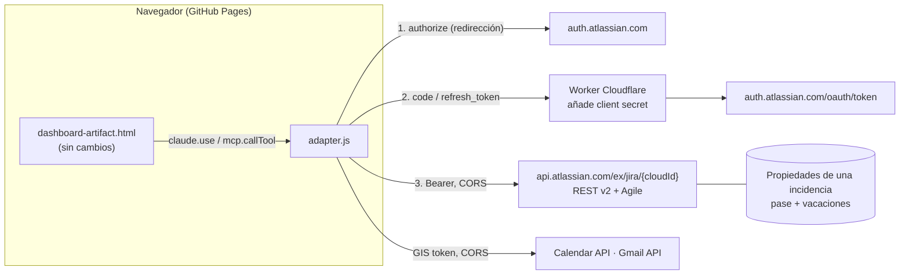

# Panel «Altima Jira» fuera de claude.ai (GitHub Pages)

Objetivo: que cualquiera del equipo pueda usar el panel con su cuenta de Atlassian (y de Google para reuniones y
correo) sin necesitar una cuenta de claude.ai de la organización, publicándolo en GitHub Pages y actualizándolo
solo en cada push a `main`.

Idea central: **no se reescribe el panel**. `dashboard-artifact.html` sigue siendo la única fuente. La versión web
añade delante un archivo, [`adapter.js`](adapter.js), que crea un `window.claude` de sustitución con la misma
interfaz (`claude.use('mcp' | 'db' | 'downloads' | …)`). La función `call(tool, input)` del panel no cambia: sigue
llamando a `mcp.callTool('Atlassian MCP', tool, input)`, y es el adaptador el que traduce cada herramienta MCP a la
API REST correspondiente y devuelve la respuesta con la forma que daba el MCP.

> **Decisión tomada:** se publica en GitHub Pages aunque la fuente quede pública. El equipo (personas, jornadas,
> accountId), los correos del pase y las personas excluidas **ya no están en la fuente**: se leen de `config/equipo`
> (§2.4).

---

## 1. Dependencias de `window.claude` y su sustituto

| Capacidad en claude.ai | Para qué la usa el panel | Sustituto en la web | Estado en `adapter.js` |
|---|---|---|---|
| `claude.use('mcp')` → **Atlassian MCP** | Todo Jira: tableros TIC/DEIS, detalle, comentarios, transiciones, imputaciones, sprint, épicas, versiones, informes SLA | API REST de Jira Cloud (`/rest/api/2`, `/rest/agile/1.0`) en `api.atlassian.com/ex/jira/{cloudId}` con OAuth 2.0 (3LO) | Hecho (tabla 1.1) |
| `claude.use('mcp')` → **Google Calendar** (`suggest_time`, `create_event`) | Buscar huecos comunes y crear la reunión con Meet | Calendar API v3 (`freeBusy` + cálculo de huecos en el navegador; `events.insert` con `conferenceData`) con Google Identity Services | Hecho |
| `claude.use('mcp')` → **Gmail** (`send_message`) | Enviar el correo del pase semanal y convocatorias | Gmail API v1 `users.messages.send` (MIME texto + HTML) | Hecho, **sin firma** automática |
| `claude.use('db')` | Lista compartida del pase semanal (`semanas/<lunes>/items`) y vacaciones (`vacaciones/<accountId>`), en tiempo real | Propiedades de una incidencia de Jira dedicada (`altima.vacaciones`, `altima.semanas.<lunes>.items`), releídas cada 20 s | Hecho. Alternativa: Supabase (§3) |
| `claude.use('sample')` | «Resumir con Claude» al imputar y redacción del informe de evolutivos | Se elimina en la web (`null`): el panel ya oculta el botón y usa el borrador automático | Hecho (desactivado) |
| `claude.use('files')` | Leer las plantillas `cau.docx` / `evo.docx` y listar informes de la carpeta del proyecto | `null`: el panel ya ofrece elegir las plantillas con un selector de archivo | Hecho (sin cambios en el panel) |
| `claude.use('downloads')` | Descargar los Word generados | `URL.createObjectURL` + enlace `download` | Hecho |
| Búsqueda **Rovo** (`search`) | «Tickets parecidos» semánticos | No hay API pública equivalente: devuelve error; la búsqueda JQL por palabras clave sigue funcionando | Sin sustituto |

### 1.1 Herramientas de Atlassian MCP → REST

| Herramienta MCP | Llamada REST | Adaptación de la respuesta |
|---|---|---|
| `atlassianUserInfo` | `GET /rest/api/2/myself` | `{accountId, name, email}` |
| `searchJiraIssuesUsingJql` | `POST /rest/api/2/search/jql` con `expand: names` | `issues.nodes`, `issues.pageInfo.{hasNextPage,endCursor}`, `nextPageToken`, `isLast`; `fields.customFields[nombre] = {id, value}` |
| `getJiraIssue` | `GET /rest/api/2/issue/{key}?expand=names` | `{issues:{nodes:[issue]}}` |
| `listJiraIssueComments` | `GET /rest/api/2/issue/{key}/comment` | tal cual (`comments`) |
| `addOrEditJiraIssueComment` | `POST`/`PUT /rest/api/2/issue/{key}/comment` | `jsmCommentType` → propiedad `sd.public.comment` (`internal`) |
| `editJiraIssue` | `PUT /rest/api/2/issue/{key}` | `{ok:true}` |
| `createJiraIssue` | `POST /rest/api/2/issue` | `{id, key}` |
| `transitionJiraIssue` | `POST /rest/api/2/issue/{key}/transitions`; con `sprintId`: `POST /rest/agile/1.0/sprint/{id}/issue` | `{ok:true}` |
| `listJiraIssueTransitions` | `GET /rest/api/2/issue/{key}/transitions` | tal cual |
| `listJiraIssueWorklogs` | `GET /rest/api/2/issue/{key}/worklog` | tal cual (`worklogs`) |
| `addOrEditJiraIssueWorklog` | `POST`/`PUT /rest/api/2/issue/{key}/worklog` | `{id, …}` |
| `getJiraBoardSprintData` | `GET /rest/agile/1.0/board/{id}/sprint?state=active` | `{resolvedSprint}` |
| `getJiraProjectVersions` | `GET /rest/api/2/project/{key}/version` | tal cual (`values`) |
| `manageJiraProjectVersion` (`create`) | `GET /rest/api/2/project/{key}` + `POST /rest/api/2/version` | versión creada |
| `executeRead` / `executeWrite` / `executeDestructive` | despachan a la herramienta `name` con `inputs` | `{data: …}` |

Se usa la API **v2** a propósito: devuelve y acepta descripción y comentarios como texto, igual que el MCP, en vez
del formato ADF de la v3.

Los errores HTTP se convierten en los códigos que el panel ya entiende: 401 → `needs_reauth`, 429 →
`rate_limited` (con `retryAfterMs`), 5xx → `server_unavailable`, resto → `tool_error` con el mensaje de Jira.

---

## 2. Arquitectura



### 2.1 ¿Admite `api.atlassian.com` llamadas desde el navegador?

Sí. La [documentación oficial de OAuth 2.0 (3LO)](https://developer.atlassian.com/cloud/jira/platform/oauth-2-3lo-apps/)
indica que hay CORS habilitado en `api.atlassian.com` para peticiones `fetch` del navegador con tokens 3LO. Las
llamadas al dominio `*.atlassian.net` **no** tienen CORS
([explicación en la comunidad de desarrolladores](https://community.developer.atlassian.com/t/oauth-2-3l-wont-work-with-local-apps-cors-issue-for-authenticated-apps/24341)).

Lo que **no** se puede hacer en el navegador es el intercambio de tokens: Atlassian solo admite el flujo de código, no
menciona PKCE, y tanto el intercambio del código como la renovación exigen el `client_secret`. Además, el refresh
token **rota** en cada uso (el anterior queda invalidado) y caduca tras 90 días sin uso.

Por eso hace falta un proxy pequeño, [`worker/oauth-proxy.js`](worker/oauth-proxy.js) (Cloudflare Workers, plan
gratuito):

- `POST /oauth/token`: recibe `code` o `refresh_token`, añade `client_id` y `client_secret` y reenvía a Atlassian.
  No guarda nada.
- `/jira/*` (opcional): reenvía a `api.atlassian.com`. Solo se usa si pones `jiraViaProxy: true`, por si alguna
  escritura fallara por CORS (hay
  [informes antiguos](https://community.developer.atlassian.com/t/oauth-2-3l-wont-work-with-local-apps-cors-issue-for-authenticated-apps/24341/9)
  de un 403 en POST).
- Solo acepta peticiones con `Origin` igual a tu sitio de Pages.

El navegador guarda el token de acceso y el refresh token en `localStorage`. Es un riesgo aceptable para una
herramienta interna, pero conviene saberlo: un script inyectado en la página podría leerlos. El panel solo carga
scripts propios y de `cdnjs` y `accounts.google.com`.

Netlify Functions sirve igual que Cloudflare Workers; se eligió Workers porque el despliegue es un solo archivo.

### 2.2 Google (Calendar y Gmail)

[Google Identity Services](https://developers.google.com/identity/oauth2/web/guides/use-token-model) con el modelo
de token: el navegador pide un token de acceso con una ventana emergente, sin secreto ni servidor. El token dura una
hora y se vuelve a pedir (sin preguntar si ya diste permiso) cuando caduca. Permisos:
`calendar.events`, `calendar.freebusy`, `gmail.send`.

`gmail.send` es un permiso «sensible». Si la app de Google Cloud se crea como **Interna** del dominio de Google
Workspace del equipo, no necesita verificación de Google. Si el equipo no comparte un Workspace, la app quedará en
modo prueba (máx. 100 usuarios añadidos a mano) con aviso de «app no verificada».

La firma de Gmail no se añade sola (pediría el permiso `gmail.settings.basic`); si hace falta, se puede añadir una
firma fija al texto.

### 2.3 Datos compartidos: pase semanal y vacaciones

Opción elegida: **propiedades de una incidencia de Jira** dedicada (por ejemplo, una tarea «Configuración del panel»
en el proyecto del equipo). Cada colección es una propiedad con valor `{docs: {id: datos}}`:

| Colección en claude.ai | Propiedad en Jira |
|---|---|
| `vacaciones` (doc = accountId) | `altima.vacaciones` |
| `semanas/<lunes>/items` | `altima.semanas.<lunes>.items` |

Ventajas: sin servicio nuevo, mismo inicio de sesión, el permiso para escribir es el de editar esa incidencia.
Límites: 32 KB por propiedad (sobrado), sin tiempo real (se relee cada 20 s y al momento tras escribir tú), y si dos
personas escriben en el mismo segundo puede perderse un cambio (leer-modificar-escribir sin bloqueo).

Alternativa si se quiere tiempo real: **Supabase** (plan gratuito) con dos tablas y Realtime. Requiere otro inicio de
sesión o un JWT emitido por el Worker, y otra pieza que mantener; solo vale la pena si el pase lo editan varias
personas a la vez con frecuencia. El adaptador aísla esto en el objeto `db`, así que el cambio no tocaría el panel.

Los datos que ya hay en la base del artefacto de claude.ai no se migran solos: se pueden volver a introducir, o
copiar una vez con un script.

### 2.4 Equipo y correos fuera de la fuente (`config/equipo`)

`dashboard-artifact.html` ya no contiene `TEAM`, `EXCLUDE`, `MAIL_TO`, `MAIL_CC` ni la lista de nombres de los
informes: se declaran vacíos y `loadTeam()` los rellena al arrancar, antes de cargar el tablero, a partir del
documento `config/equipo` de la base compartida:

```json
{
  "team":     [{"id": "<accountId>", "name": "Jane Doe", "h": 8.5, "mail": "jdoe@example.com"}],
  "exclude":  ["<accountId que no se muestra>"],
  "mailTo":   ["<destinatario del pase>"],
  "mailCc":   ["<copias del pase>"],
  "informes": ["<nombres cuyas horas cuentan en los informes CAU/evolutivos>"]
}
```

| Dónde se abre el panel | Dónde vive `config/equipo` |
|---|---|
| claude.ai (artefacto) | base `db` del artefacto, documento `config/equipo` |
| Web (GitHub Pages) | propiedad de Jira `altima.config` de la incidencia `ALTIMA_STORE_ISSUE` (el adaptador la sirve como `db.doc('config/equipo')`) |

El código es el mismo en los dos sitios. Si el documento no existe, el panel funciona pero sin personas ni
destinatarios, y muestra un aviso con el botón **Cargar equipo.json**, que guarda el archivo en `config/equipo` y
recarga (hace falta permiso de escritura: Colaborador en el artefacto, o editar la incidencia en Jira).

Los datos reales que había en la fuente se han guardado en `web/equipo.local.json`, que **no se sube** (lo cubre
`*.local.json` del `.gitignore`). Es el archivo que hay que cargar con el botón en cada sitio.

`build.mjs` se niega a generar la web si la fuente vuelve a contener un correo o un accountId, para que no se cuelen
al añadir funciones. Siguen en la fuente, y por tanto públicos, el cloudId, la URL del sitio, los componentes, los
filtros y JQL, y el histórico de horas `HIST0`.

### 2.5 Resúmenes de IA

Se eliminan en la web. Si en el futuro se quieren, el Worker podría llamar a la API de Anthropic con una clave guardada
como secreto del Worker y una ruta `/ai`; tendría coste por uso y habría que limitarla.

---

## 3. Capa de adaptación

Archivo: [`adapter.js`](adapter.js). Se carga **solo** en la versión web y no hace nada si `window.claude` ya existe,
así que el mismo `dashboard-artifact.html` funciona en claude.ai y en la web.

```js
// En el panel (sin cambios):
async function call(tool, input){
  return (await mcp.callTool(SERVER, tool, input, {cache:false})).payload;
}
// En claude.ai, mcp = claude.use('mcp') de la plataforma.
// En la web, mcp = claude.use('mcp') de adapter.js:
const mcp = {
  async callTool(server, tool, input){
    const f = SERVERS[server]?.[tool];          // 'Atlassian MCP' | 'Google Calendar' | 'Gmail'
    if(!f) throw fail('not_in_manifest', `${server}/${tool} no está disponible en la versión web`);
    return {payload: await f(input || {})};     // misma forma que la respuesta MCP
  },
};
```

Si una función nueva del panel usa una herramienta MCP que aún no está en `JIRA_TOOLS`, la web mostrará «no está
disponible en la versión web» hasta que se añada su traducción (normalmente 2–3 líneas).

[`build.mjs`](build.mjs) genera `_site/` sin tocar la fuente: inserta delante del primer `<script>` del panel la
librería de Google, `config.js` y `adapter.js`, y añade el esqueleto HTML que claude.ai pone al publicar.

Retoques recomendados en el panel (opcionales, no bloquean): los mensajes de error dicen «claude.ai → Ajustes →
Conectores»; en la web convendría un texto neutro («vuelve a iniciar sesión»).

Comprobado en local: los scripts compilan, el build genera `_site/index.html`, y una prueba con `fetch` simulado
confirma la forma de `searchJiraIssuesUsingJql`, `customFields`, el paso a sprint, los errores y el `db` (alta,
orden y borrado). **No se ha probado contra Jira ni Google reales**, porque requiere las apps OAuth que debes crear tú.

---

## 4. Publicación automática

> **Cómo está publicado ahora:** repositorio público `oysdeister/altima-jira-web`, GitHub Pages en modo *Deploy from a branch* (`main`, raíz). `index.html` carga `config.js`, `adapter.js` y `dashboard-artifact.html` en el navegador, sin build ni Actions, y Pages se republica sola en cada push. Lo que sigue (workflow con variables) es la alternativa con Actions, que necesita un token de GitHub con permiso `workflow`.

[`.github/workflows/pages.yml`](../.github/workflows/pages.yml): en cada push a `main` que toque
`dashboard-artifact.html`, `web/**` o el propio workflow (o a mano desde Actions):

1. Comprueba que `dashboard-artifact.html` está en el repositorio.
2. Genera `web/config.js` a partir de las **variables** del repositorio (no hay secretos: el client secret está solo
   en el Worker).
3. Ejecuta `node web/build.mjs` y publica `_site/` con `actions/deploy-pages`.

---

## 5. Publicación pública: qué se decidió

- **GitHub Pages es público** (solo Enterprise Cloud permite restringirlo): cualquiera con la URL descarga el HTML.
  No ve tickets sin iniciar sesión en Atlassian con acceso al sitio. Se ha aceptado que la fuente quede pública, y
  el equipo y los correos se han sacado a `config/equipo` (§2.4).
- `dashboard-artifact.html` ya **no** está en `.gitignore`: el workflow lo necesita.
- **Pages desde un repositorio privado necesita GitHub Pro, Team o Enterprise.** Con el plan gratuito, el repositorio
  tiene que ser público. Ojo: el repositorio actual también contiene los plugins de Elysius, así que puede convenir
  un repositorio público aparte solo con `dashboard-artifact.html`, `web/` y `.github/workflows/pages.yml`.
- Alternativa descartada por ahora: Cloudflare Pages + Cloudflare Access (sitio privado por dominio de correo).

---

## 6. Pasos que tienes que hacer tú

Nada de esto se ha creado: ni repositorio remoto, ni apps OAuth, ni secretos.

### 6.1 Repositorio y Pages
1. Elige el repositorio público (el actual hecho público, o uno nuevo solo con el panel; §5).
2. Haz commit de `dashboard-artifact.html` (ya sin datos del equipo), `web/` y `.github/`. **No** subas
   `web/equipo.local.json`.
3. En GitHub: **Settings → Pages → Build and deployment → Source: GitHub Actions**.
4. Anota la URL que tendrá el sitio: `https://<usuario>.github.io/<repositorio>/`. Es la **URL de redirección** de
   los pasos siguientes (con la barra final).

### 6.2 App de Atlassian ([developer.atlassian.com/console/myapp](https://developer.atlassian.com/console/myapp/))
1. **Create → OAuth 2.0 integration**, nombre «Altima Jira web».
2. **Authorization → OAuth 2.0 (3LO) → Callback URL**: la URL de redirección del §6.1.
3. **Permissions → Jira API**, añade:
   - Clásicos: `read:jira-work`, `write:jira-work`, `read:jira-user`, `manage:jira-project` (este solo para crear
     versiones; quien la cree necesita además permiso de administrar el proyecto).
   - Jira Software (granulares): `read:board-scope:jira-software`, `read:sprint:jira-software`,
     `write:sprint:jira-software`.
   - Si la consola no deja mezclar clásicos y granulares, dímelo y ajusto `SCOPES` en `adapter.js`.
4. **Distribution**: mientras esté en desarrollo solo tú (el propietario) puedes iniciar sesión. Para el equipo:
   **Sharing → Enable sharing** (o «Distribution status: Sharing»). No hace falta publicarla en Marketplace.
5. **Settings**: copia el **Client ID** y el **Secret** (el secreto solo irá al Worker).
6. Averigua el `cloudId` (ya está en la fuente como `CLOUD`) y la incidencia que guardará el pase y las vacaciones
   (créala si no existe; todos los que editen el pase deben poder editarla).

### 6.3 App de Google ([console.cloud.google.com](https://console.cloud.google.com/))
1. Crea un proyecto «Altima Jira web».
2. **APIs y servicios → Biblioteca**: habilita **Google Calendar API** y **Gmail API**.
3. **Pantalla de consentimiento de OAuth**: tipo **Interno** si el equipo comparte Google Workspace; si no,
   **Externo** en modo prueba y añade a cada compañero como usuario de prueba. Permisos: `calendar.events`,
   `calendar.freebusy`, `gmail.send`.
4. **Credenciales → Crear → ID de cliente de OAuth → Aplicación web**. **Orígenes de JavaScript autorizados**:
   `https://<usuario>.github.io` (sin ruta). No hace falta URI de redirección.
5. Copia el **Client ID**.

### 6.4 Worker de Cloudflare
1. Cuenta gratuita en Cloudflare.
2. En `web/worker/`: copia `wrangler.toml.example` como `wrangler.toml` y rellena `ALLOWED_ORIGIN`
   (`https://<usuario>.github.io`), `ATLASSIAN_CLIENT_ID` y `CLOUD_ID`.
3. Guarda el secreto y despliega:

```bash
npx wrangler secret put ATLASSIAN_CLIENT_SECRET
```

```bash
npx wrangler deploy
```

4. Anota la URL del Worker (`https://altima-jira-oauth.<subdominio>.workers.dev`).

### 6.5 Variables del repositorio

> En la publicación actual (sin Actions) no hay variables: rellena los mismos valores directamente en `config.js` del repositorio y haz push.
**Settings → Secrets and variables → Actions → Variables** (pestaña *Variables*, no *Secrets*):

| Variable | Valor |
|---|---|
| `ALTIMA_CLOUD_ID` | cloudId del sitio de Jira |
| `ATLASSIAN_CLIENT_ID` | Client ID de la app de Atlassian |
| `ALTIMA_REDIRECT_URI` | `https://<usuario>.github.io/<repositorio>/` |
| `ALTIMA_PROXY_URL` | URL del Worker, sin barra final |
| `GOOGLE_CLIENT_ID` | Client ID de Google |
| `ALTIMA_STORE_ISSUE` | clave de la incidencia del pase y las vacaciones |
| `ALTIMA_JIRA_VIA_PROXY` | `false` (cámbialo a `true` solo si las escrituras fallan por CORS) |

### 6.6 Primera publicación y prueba
1. Haz push a `main` (o **Actions → Publicar panel web → Run workflow**).
2. Abre la URL, pulsa **Entrar con Atlassian** y acepta los permisos. Saldrá el aviso de configuración del equipo:
   pulsa **Cargar equipo.json** y elige `web/equipo.local.json` (solo la primera vez; queda en la propiedad de Jira).
3. Comprueba: tablero TIC, detalle y comentarios,
   una imputación de prueba, el sprint DEIS, el pase (añadir y quitar), y buscar hueco de reunión.
4. **Artefacto de claude.ai**: la fuente ha cambiado, pero el artefacto publicado no. Cuando se vuelva a publicar,
   su base `db` no tendrá `config/equipo`: carga el mismo `equipo.local.json` con el botón del aviso (o pídeselo a
   Claude, que puede escribirlo en la base del artefacto).
5. Para probar en local antes: copia `web/config.example.js` como `web/config.js`, añade
   `http://localhost:8080/` como Callback URL en Atlassian y `http://localhost:8080` como origen en Google y en
   `ALLOWED_ORIGIN`, y sirve la carpeta:

```bash
node web/build.mjs && npx serve _site -l 8080
```

---

## 7. Qué cambia para el usuario respecto a claude.ai

- Inicio de sesión propio con Atlassian (una vez; dura mientras se use al menos cada 90 días) y con Google la primera
  vez que se busca hueco o se envía un correo.
- Sin «Resumir con Claude» ni redacción automática del informe de evolutivos (queda el borrador automático).
- Sin búsqueda semántica Rovo en «Tickets parecidos».
- Las plantillas Word se eligen con el selector de archivo.
- El pase y las vacaciones se actualizan cada 20 s en lugar de al instante.
- El correo sale sin la firma de Gmail.
